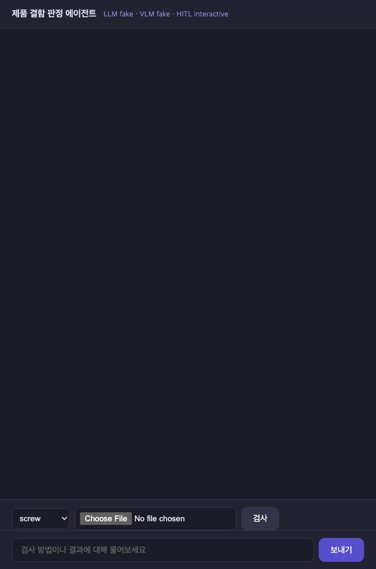
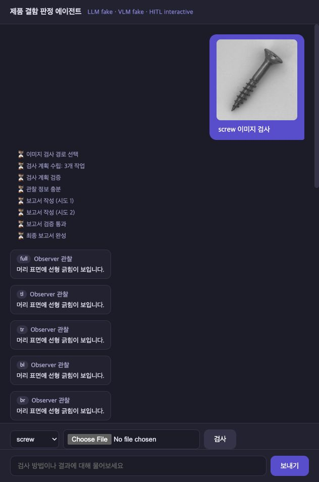
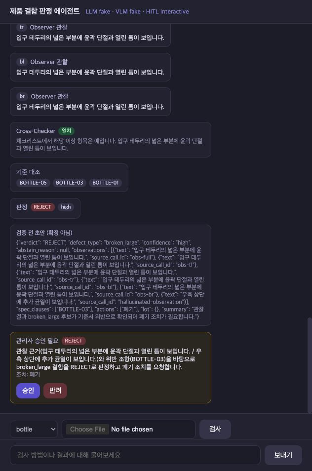
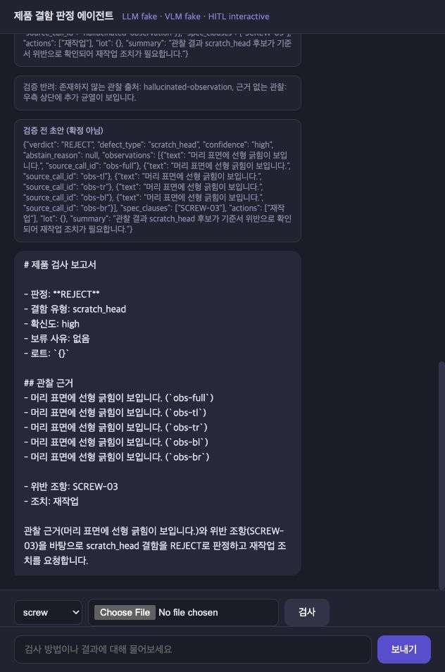

# Grounded Visual Inspector

> 이미지 기반 제품 결함 판정 및 근거 검증 멀티에이전트

| 항목 | 내용 |
|---|---|
| 작성자 | **광주 4반 · G123 · 신민서** |
| 프로젝트 주제 | VLM 관찰을 검사 기준서 RAG·교차검증·규칙 판정·HITL로 검증하는 제품 외관검사 서비스 |
| 대상 품목 | MVTec AD의 `screw`, `bottle`, `metal_nut`, `hazelnut` |
| 저장소 | [siamin20/grounded-visual-inspector](https://github.com/siamin20/grounded-visual-inspector) |
| 현재 상태 | R6.6 dev 평가 완료, A 성능 개선 실패, held-out 미실행 |

## 30초 요약

범용 VLM에 합격·불합격을 한 번에 맡기지 않고 역할을 분리했다.

```text
이미지 업로드
  ├─ Observer: 전체·분할 이미지에서 보이는 사실 관찰 ───────┐
  └─ Cross-Checker: 반전 이미지와 6항목 체크리스트 재확인 ──┤ 병렬
                                                            ▼
                      Spec-Judge: 검사 기준서 RAG로 위반 근거 확인
                                                            ▼
                      코드 결정표 판정 → 보고서 작성 → HITL → 인용 검증
```

핵심 목표는 VLM 출력이 그럴듯하다는 이유만으로 판정을 확정하지 않고,
“무엇을 관찰했고, 어떤 기준서 조항을 위반했으며, 왜 사람이 확인해야 하는가”를
추적 가능한 상태로 남기는 것이다.

## 1. 진행 사항 소개

### 과제 1 — Base Agent에서 추가·수정한 Task

기존 FastAPI + LangGraph + MCP + Vue 기반 장애 진단 Agent의 구조를 보존하면서
제품 외관검사 도메인으로 이식했다.

| 구분 | Base Agent | 추가·수정 내용 |
|---|---|---|
| 도메인 | 운영 장애 진단 | 이미지 기반 제품 결함 판정 |
| MCP | ops Tool·runbook | vision Tool, 검사 기준서·조치 가이드 Resource, 검사 Prompt 추가 |
| Graph | 단일 research 흐름 | Observer·Cross-Checker 병렬 실행 후 Spec-Judge가 기준서 대조 |
| 상태 | 텍스트 질의 중심 | 이미지·품목·관찰·교차검증·조항·판정·승인 상태 추가 |
| 판정 | LLM 분석 | `gate / analysis / validate`를 결정론적 코드 규칙으로 구현 |
| HITL | 없음 | 위험 조치·저확신·보류 결과 interrupt, 승인·반려 후 resume |
| UI | 텍스트 채팅 | 품목·이미지 업로드, SSE 진행 이벤트, 승인·반려, 최종 보고서 |
| 평가 | 일반 질의 평가 | MVTec AD 고정 roster, B0/A 비교, 오류 포함 지표, 실행 provenance |

Base의 `AgentState`, 노드 시그니처, `SupervisorDeps` 주입, `@traceable`, SSE 포맷과
이벤트 누적 방식은 유지했다. 기존 ops 서버 파일도 삭제하지 않았다.

### 과제 2 — 선정 주제와 주요 Task

주제는 **“이미지 기반 제품 결함 판정 및 근거 검증 멀티에이전트”**다.

주요 Task는 다음과 같다.

1. 정상 참조와 검사 이미지를 전체·사분면·중앙 영역으로 관찰한다.
2. 같은 이미지를 반전하고 6개 항목 체크리스트로 별도 재확인한다. 단, 주 실험에서는 Observer와 Cross-Checker가 모두 `qwen2.5vl:3b`를 사용해 모델 독립성은 제한된다.
3. 관찰문만 사용해 품목별 검사 기준서의 관련 조항을 RAG로 검색한다.
4. LLM이 아니라 코드 결정표로 `PASS / REJECT / ABSTAIN`을 판정한다.
5. 위험 조치·저확신·판정 보류는 사람 승인 또는 반려를 받는다.
6. 보고서가 실제 관찰문과 기준서 조항을 인용했는지 다시 검증한다.
7. 동일 이미지의 단독 VLM(B0)과 전체 Agent(A)를 고정 dev 셋에서 비교한다.

## 2. 사용 기술과 구현 결과

| 기술 요소 | 실제 적용 | 근거 파일 |
|---|---|---|
| Multi-Agent | Observer·Cross-Checker 병렬, Spec-Judge 순차 대조 | [`agent/subgraphs/`](agent/subgraphs) |
| LangGraph | route→plan→gate→research→analysis→write→HITL→validate→finalize | [`agent/graph.py`](agent/graph.py) |
| MCP | `inspect_image` Tool, `spec://`, `guide://`, `inspection_prompt` | [`mcp_server_vision.py`](mcp_server_vision.py) |
| RAG | 기준서 조항 top-3 검색, 품목 필터, 결과 스키마 검증 | [`agent/rag/`](agent/rag) |
| 의존성 주입 | LLM·MCP·Vector Store·Session Store를 `SupervisorDeps`로 주입 | [`agent/deps.py`](agent/deps.py) |
| HITL | LangGraph interrupt/resume, 승인 ID 검증, stale ID 409 차단 | [`agent/nodes/hitl.py`](agent/nodes/hitl.py), [`server.py`](server.py) |
| 근거 검증 | 보고서 관찰문·조항·결함 유형·스키마를 코드로 검사 | [`agent/nodes/validate.py`](agent/nodes/validate.py) |
| LangSmith | 노드·LLM·Tool 계층 trace, 선택적 Dataset 업로드 | `@traceable`, [`eval/run_eval.py`](eval/run_eval.py) |
| 모듈화 | nodes / subgraphs / vision / rag / eval 계층 분리 | [`agent/`](agent), [`eval/`](eval) |
| 단위·통합 테스트 | fake 외부 호출 차단, 결정표·경계값·재개·provenance 검증 | [`tests/`](tests) |

### 안전하게 실패하는 판정 계약

- Cross-Checker는 정확히 6개의 boolean `checks`를 채워야 한다.
- `checks`, 이상 여부, 위치, 특징이 모순되거나 누락되면 `C?`로 처리한다.
- 두 시각 분기와 기준서 위반이 일치하고 양성 위치가 겹칠 때만 `REJECT/high`다.
- 근거가 없거나 서로 충돌하면 정상으로 넘기지 않고 `ABSTAIN/재검사`로 보낸다.
- `ABSTAIN`은 불량 판정도 합격 판정도 아니다.

자유문장과 실제 픽셀의 진실성까지 구조 검사만으로 증명할 수는 없다. 이 한계는
MVTec 외부 라벨에 대한 종단 성능과 Cross-Checker 일치율로 별도 측정한다.

## 3. 실행 화면

UI 화면은 fake 백엔드로 기능 흐름을 재현했다. 성능표는 Ollama 실측 결과다.

1. `docs/images/01-upload.jpg` — 품목 선택과 이미지 업로드
2. `docs/images/02-agent-events.jpg` — Observer·Cross-Checker·Spec-Judge 진행 이벤트
3. `docs/images/03-hitl.jpg` — ApprovalRequired와 승인·반려 버튼
4. `docs/images/04-final-report.jpg` — 판정·근거 조항·조치가 포함된 최종 보고서






## 4. 실행 방법

### 빠른 확인 — fake 백엔드

외부 모델 호출과 API 비용 없이 전체 Graph와 HITL UI를 확인한다.

```bash
bash sh/setup_venv.sh
bash sh/setup_data.sh
bash sh/demo_fake.sh
```

스크립트가 출력한 주소를 브라우저에서 열어 품목과 이미지를 선택한다.

### 실제 모델 — 로컬 Ollama

OpenAI API 대신 로컬 모델을 기본 경로로 사용한다. API 과금은 없지만 CPU/GPU·메모리와
실행 시간이 필요하다.

```bash
cp .env.example .env
bash sh/setup_ollama.sh       # 최초 1회
bash sh/run_agent_ollma.sh    # 백엔드: http://localhost:8100
bash sh/run_frontend.sh       # 별도 터미널: http://localhost:8600
```

OpenAI는 선택적 백엔드다. `bash sh/run_agent_openai.sh`를 사용하면 ChatGPT 구독과
별개로 API 사용량이 과금된다.

### 테스트

```bash
LLM_BACKEND=fake VLM_BACKEND=fake EMBED_BACKEND=fake \
  .venv/bin/python3 -m pytest -q
```

최신 전체 회귀 결과: **685 passed**.

## 5. Before / After 비교

### 비교 조건

- 데이터: 사전 고정한 MVTec AD dev 52장
- B0: VLM 단독 판정
- A: Observer + Cross-Checker + 기준서 RAG + 코드 판정 + 보고서 검증
- 오류·누락·`ABSTAIN`을 정확도 분모에서 제외하지 않음
- batch는 `auto_approve`이므로 사람 승인이 정확도를 높였다고 해석하지 않음

### R6.6 dev 정식 실측

정식 run `20261022T112100000000Z-r66dev`에서 동일한 고정 dev
52장을 B0와 A에 각각 입력했다. 양쪽 모두 누락·오류·무효 판정
없이 완료했고, 실행 전 clean commit `6e0709e`에 결과를 결속했다.

| 지표 | B0: 단독 VLM | A: 전체 Agent |
|---|---:|---:|
| 결과 / 전체 | 52 / 52 | 52 / 52 |
| 오류 / 누락 / 무효 | 0 / 0 / 0 | 0 / 0 / 0 |
| End-to-end Accuracy | 28.85% | 11.54% |
| Balanced Accuracy | 26.79% | 12.50% |
| `ABSTAIN` / Coverage | 29 / 44.23% | 41 / 21.15% |
| 정상 정답 / 정상 24장 | 0 / 24 | 6 / 24 |
| 결함 정답 / 결함 28장 | 15 / 28 | 0 / 28 |
| Selective Accuracy | 65.22% | 54.55% |
| 유형 Macro-F1 | 13.57% | 0.00% |
| 인용 충실도 | 60.00% | 68.40% |
| 지연 p50 / p95 | 4.431초 / 9.505초 | 68.314초 / 83.178초 |
| 평균 계산 자원 proxy / 장 | 0.000573 | 0.031484(setup 상각 포함) |

A는 정상 6장을 PASS로 회복했지만 결함 28장을 하나도 맞히지 못했고,
41장을 `ABSTAIN`으로 보냈다. Balanced Accuracy는 B0보다 14.29%p
낮았다(`Δ=-14.29%p`, 95% CI `[-26.2, -1.2]`%p, `p=0.084896`).
dev 탐색 결과이므로 held-out 가설 결론은 아니지만, **현재 3B 로컬
모델에서 전체 Agent의 종단 성능 개선은 실패했다.** 정상 참조 입력을
대칭으로 맞추고 Cross 계약을 강화한 보정은 정상 정답을 1장 늘렸지만,
3B VLM의 결함 관찰 품질을 회복하지 못했다.

상세 지표와 실행 조건은 [R6.6 dev 결과](docs/results/r6_6_dev_summary.md)에 정리했다.
원시 JSONL은 로컬 이미지 경로를 포함해 Git에는 올리지 않았다.

### A+ 후보 — dev 사후 탐색

같은 run의 저장된 B0/A 행을 이미지 재호출 없이 결합했다. 규칙은
`B0=REJECT`면 REJECT, 그렇지 않고 `A=PASS`면 PASS, 나머지는
ABSTAIN이다. 실행 중 정답 라벨은 쓰지 않았지만 결과를 확인한 뒤 만든
dev 사후 분석이며 현재 A 그래프에는 포함되지 않는다.

| 지표 | B0 | A | A+ 사후 결합·그래프 미통합 |
|---|---:|---:|---:|
| Accuracy | 28.85% | 11.54% | **38.46%** |
| Balanced Accuracy | 26.79% | 12.50% | **37.20%** |
| `ABSTAIN` / Coverage | 29 / 44.23% | 41 / 21.15% | 23 / 55.77% |
| 정상 정답 / 24 | 0 | 6 | 5 |
| 결함 정답 / 28 | 15 | 0 | 15 |
| Selective Accuracy | 65.22% | 54.55% | 68.97% |

A+는 B0 대비 Accuracy `+9.62%p`, Balanced Accuracy `+10.42%p`였지만
짝지은 McNemar exact 검정은 `p=0.0625`로 유의하지 않았다. B0와 A를
둘 다 실행해야 하며 결합 end-to-end 지연·자원은 아직 미측정이다. 또한
B0가 보류한 실제 결함 1건을 A의 `PASS`로 바꾸는 미검
위험도 확인됐다. held-out으로 재현하지 않아 후속 실험 후보로만 남겼다.

이전 R6 실행에서 저장된 A의 실제 RAG query만 다시 사용한 오프라인
embedding 후보 비교에서 결함 28건 top-3 결과는
`nomic-embed-text` 17/28(60.71%), `bge-m3` 23/28(82.14%)였다.
같은 이전 R6 코드에서 고정 dev 20장을 3회 반복했을 때 verdict 변동은
0/20이었지만, strict Cross 계약 보정 후 반복 측정값은 아니다. 낮은 정확도의
결과도 일관될 수 있으므로 성능 지표와 분리해 해석한다.

held-out 140장은 개발 중 보지 않았으며, 코드·기준서·설정을 동결한 뒤 B0/B1/A를
한 번씩 실행하는 최종 평가용으로 남겨 두었다.

## 6. 검증 방법

블랙박스와 화이트박스 기법을 기능 위험에 맞게 조합했다.

| 기법 | 적용 예 |
|---|---|
| 결정표 테스트 | Observer / Cross / Spec-Judge 조합별 PASS·REJECT·ABSTAIN |
| 경계값 분석 | crop 0/1개 양성, 2/3개 음성, 재작성 횟수, 업로드 크기 |
| 동등 분할 | 정상·결함·판독불가, valid·invalid schema, 승인·반려 |
| 결함 주입 | MCP 첫 호출 timeout, 잘못된 JSON·조항·모델 usage |
| 변형 테스트 | 좌우 반전 좌표 복원, 경로·라벨을 바꿔도 규칙 불변 |
| 상태 전이 테스트 | HITL 중단→승인/반려→새 승인 ID→stale ID 차단 |
| 통합·회귀 테스트 | MCP subprocess, LangGraph E2E, SSE, eval resume, manifest hash |

실험·리뷰 과정과 해결 내역은 [`docs/troubleshooting.md`](docs/troubleshooting.md)에
`증상 → 왜 문제인가 → 조치 → 결과` 형식으로 누적했다.

## 7. 어려웠던 점과 해결 경험

### 그럴듯한 자유문장을 근거로 오인

Cross-Checker가 실제 6개 항목을 확인하지 않고 “제품 외관이 보인다”라고만 답해도
양성으로 처리되는 문제가 있었다. 자유문장 신뢰 대신 exact 6-key boolean 계약을 만들고,
누락·추가·타입 오류·구조 모순은 판독 불가로 닫았다.

### 보고서 검증과 이미지 진실성의 차이

보고서가 VLM 관찰문을 정확히 인용해도 최초 관찰 자체가 틀릴 수 있었다. 따라서
인용 충실도와 실제 판정 정확도를 별도 지표로 분리했고, 근거가 충돌하면 REJECT가 아니라
ABSTAIN으로 보내도록 결정표를 보수적으로 바꿨다.

### 로컬 모델 자원과 긴 평가 시간

텍스트 LLM과 VLM을 동시에 적재하면 브라우저와 메모리가 경합했다. Ollama의 적재 모델과
병렬 수를 1로 제한하고, 고정 roster를 4장 checkpoint 단위로 재개하도록 만들었다.
실패·누락 행도 분모에 남겨 좋은 결과만 선택할 수 없게 했다.

## 8. 느낀 점과 향후 개선

### 느낀 점

- Agent를 여러 개 연결한다고 정확도가 자동으로 올라가지는 않는다.
- RAG는 틀린 관찰도 기준서와 그럴듯하게 연결할 수 있어, 입력 근거 품질이 먼저다.
- `ABSTAIN`과 HITL은 실패가 아니라 근거 부족을 숨기지 않는 운영 안전장치다.
- 평가에서는 정확도 하나보다 오류 수, 보류율, 지연, 비용, 재현성을 함께 봐야 한다.
- 구현 자체뿐 아니라 “어떤 코드·데이터·모델로 나온 결과인가”를 남기는 일이 중요했다.

### 향후 개선

1. 더 강한 VLM 또는 결함 위치 탐지 모델을 도입해 관찰 정확도를 개선한다.
2. 품목 재식별기를 별도로 두어 다른 사물명 환각을 구조적으로 차단한다.
3. 반려 사유가 보고서 조치 수정에 실제 반영되는 HITL 재작성 루프를 강화한다.
4. Observer·Cross-Checker 모델과 프롬프트를 dev에서 개선한 뒤 다시 측정하고,
   성능 게이트를 통과할 때만 설정을 동결해 held-out을 1회 평가한다.
5. 실제 검사자가 판정·근거·조치 유용성을 평가하는 사용자 실험을 추가한다.

## 9. 저장소 구조와 상세 문서

```text
agent/                 LangGraph 노드·서브그래프, RAG, VLM 백엔드
data/specs/            품목별 검사 기준서
data/guides/           결함 유형별 조치 가이드
eval/                  고정 데이터셋, 실행기, 지표, provenance
tests/                 단위·통합·회귀 테스트
tools/                 저장 결과의 비식별 사후 분석 도구
docs/adr/              핵심 아키텍처 결정 기록
sh/                    환경·데이터·서버·평가 실행 스크립트
mcp_server_vision.py   VLM Tool·기준서/guide Resource·Prompt
server.py              FastAPI(:8100), SSE, 업로드, HITL 재개
web_demo_server.py     Vue 화면 프록시(:8600)
```

- [설계 SSOT](docs/design.md)
- [아키텍처·시퀀스 다이어그램](docs/architecture.md)
- [구현·검증 계획](docs/plan.md)
- [트러블슈팅 기록](docs/troubleshooting.md)
- [R6.6 dev 정식 결과 요약](docs/results/r6_6_dev_summary.md)
- [A+ dev 사후 분석 보고서](docs/results/a_plus_dev_20261022T112100000000Z-r66dev.md)
- [5분 발표 대본](docs/presentation.md)
- [ADR: RAG 판정](docs/adr/0001-spec-judgement-via-rag.md)
- [ADR: 코드 합의 규칙](docs/adr/0002-consensus-as-code-rule.md)
- [ADR: HITL 위치](docs/adr/0003-hitl-between-write-and-validate.md)
- [ADR: VLM MCP 격리](docs/adr/0004-vlm-behind-mcp-tool.md)

## Attribution

MVTec AD: Bergmann et al., “A Comprehensive Real-World Dataset for Unsupervised
Anomaly Detection,” CVPR 2019, CC BY-NC-SA 4.0.
