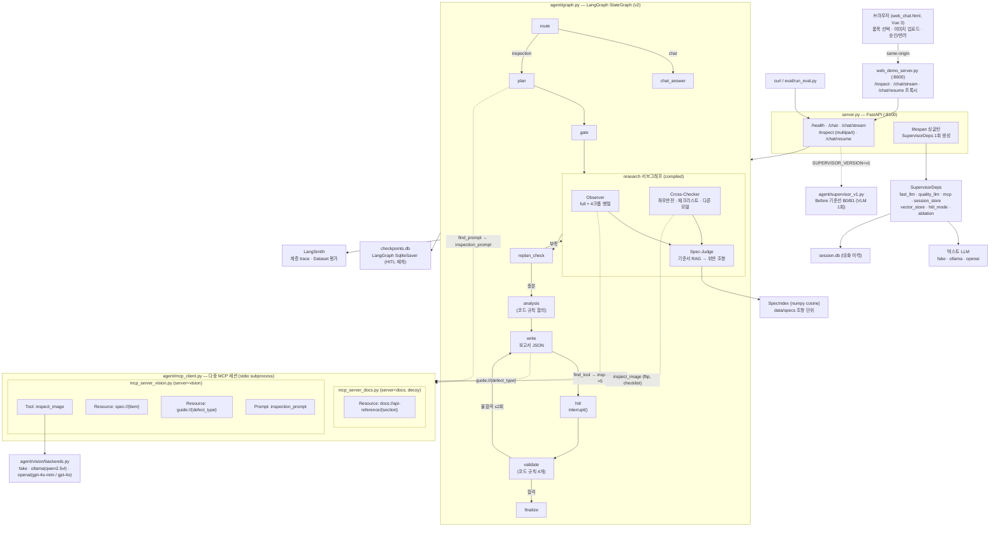
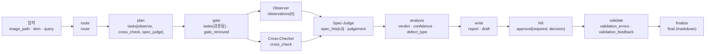
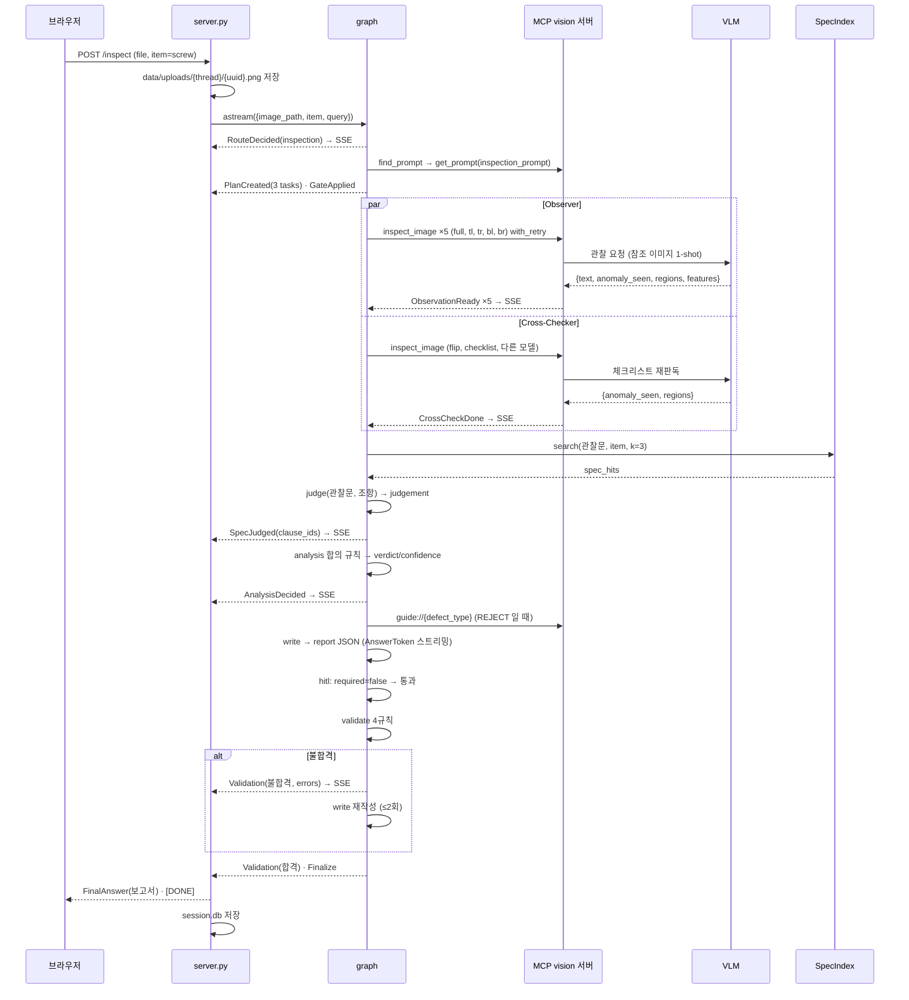
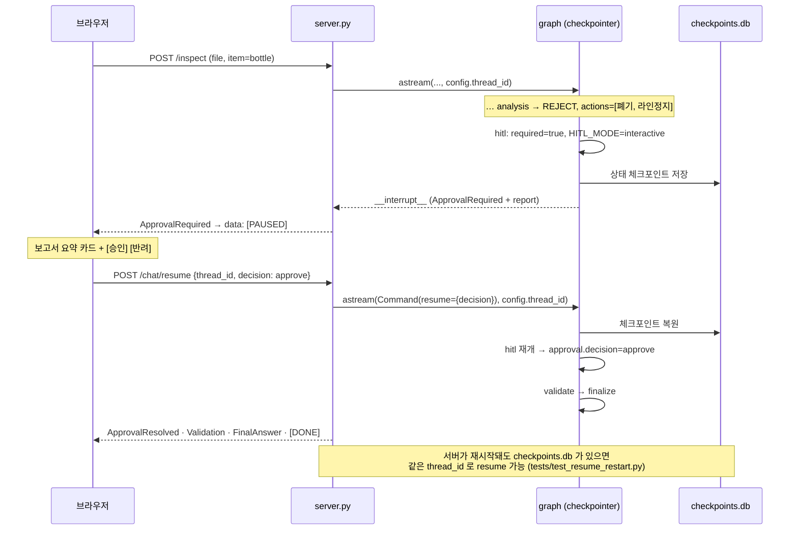
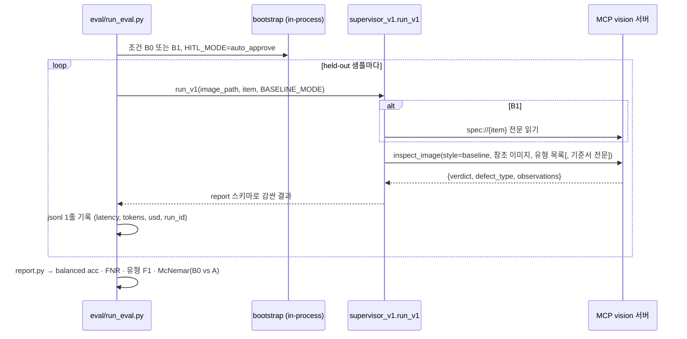
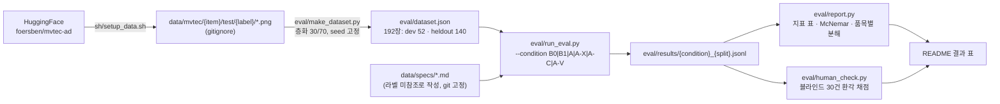

# 아키텍처와 흐름도

설계 본문은 [design.md](design.md). 이 문서는 그림만 모은다. GitHub 에서 mermaid 로 렌더된다.

## 1. 전체 구성도

핵심 원칙 네 가지가 그림에 드러나야 한다.
- VLM 은 MCP tool 뒤에만 있다. 그래프 노드는 VLM 을 직접 모른다.
- research 는 2단계다. Observer 와 Cross-Checker 가 병렬, Spec-Judge 는 Observer 의 관찰문을 받아 뒤에 돈다.
- gate · analysis · validate 는 LLM 을 부르지 않는다.
- Before(v1)와 After(v2)는 같은 서버에서 환경변수 하나로 갈린다.

## 2. 그래프 상태 흐름 (무엇이 어느 노드에서 채워지는가)

## 3. 시퀀스 — 검사 요청 (정상 흐름, HITL 불필요)

## 4. 시퀀스 — HITL 승인 (interrupt → resume)

## 5. 시퀀스 — Before 기준선 (v1, 평가용)

## 6. 평가 데이터 흐름

정답 라벨은 폴더명(외부)에서만 온다. 기준서는 판정의 참고 자료이지 채점 기준이 아니다.
