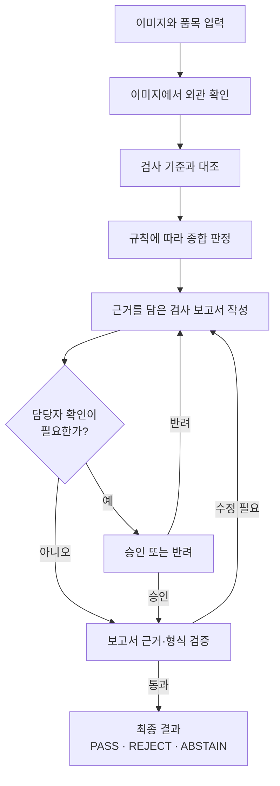
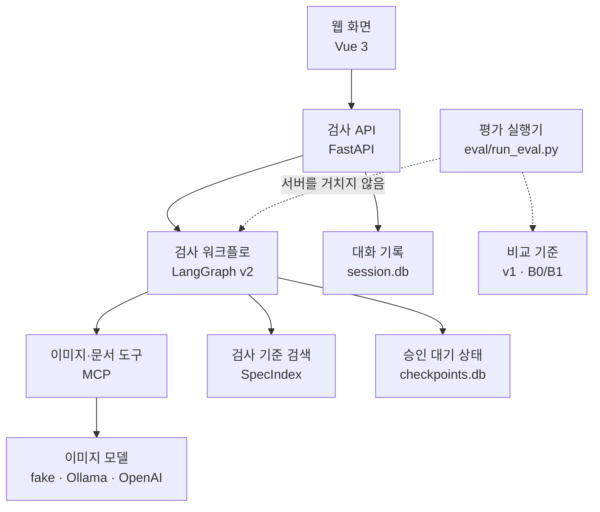
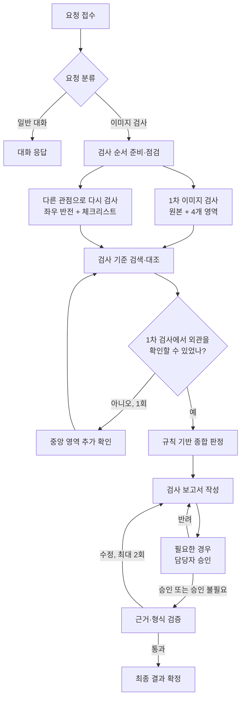
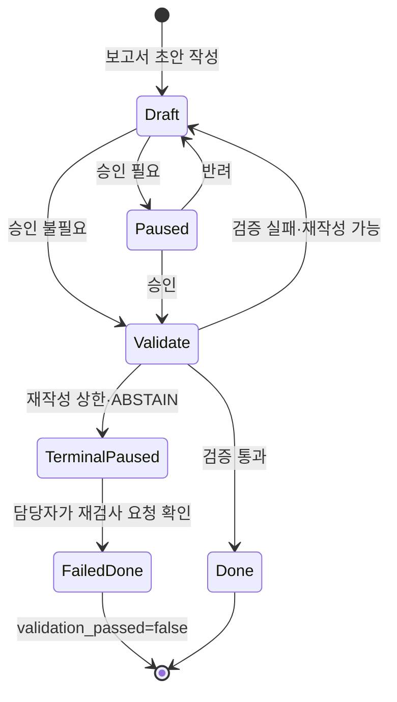
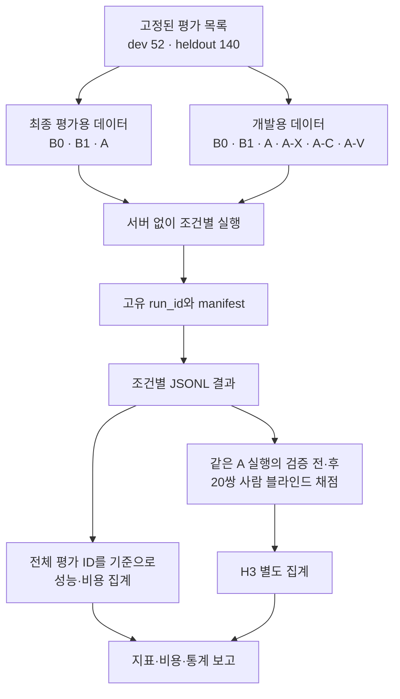

# 시스템 구조와 검사 흐름

세부 설계의 단일 기준은 [design.md](design.md)다. 이 문서는 전체 흐름을
먼저 보여 준 뒤, 구현 구조·상세 처리·담당자 승인·평가 흐름을 나누어
설명한다. 그림에서는 읽기 쉬운 역할명을 먼저 쓰고, 코드의 노드명은
표에서 함께 밝힌다.

## 1. 검사 과정 한눈에 보기

이 그림은 사용자가 경험하는 핵심 흐름만 보여 준다. 서버, MCP, 데이터베이스,
평가 도구는 아래 절로 분리했다.

- 담당자 승인은 매번 요구하지 않는다. 확신도가 낮거나, 판정을 낼 수 없거나,
  폐기·라인 정지처럼 위험도가 높은 조치가 있을 때만 멈춘다.
- 이미지에서 충분한 정보를 얻지 못하면 중앙 영역을 한 번 더 확인한다.
  이 세부 분기는 전체 흐름을 읽기 쉽게 하기 위해 첫 그림에서 생략했다.

## 2. 구성요소와 책임

| 구성요소 | 하는 일 | 구현 |
|---|---|---|
| 웹 화면 | 품목·이미지 입력, 검사 과정 표시, 승인·반려 | `web_chat.html`, `web_demo_server.py` (`:8600`) |
| 검사 API | 요청 검증, 파일 저장, SSE 스트리밍, 중단된 검사 재개 | `server.py` (`:8100`) |
| v2 검사 워크플로 | 외관 확인부터 보고서 확정까지 단계별로 실행 | `agent/graph.py` |
| v1 비교 기준 | VLM 한 번으로 B0·B1 조건 실행 | `agent/supervisor_v1.py` |
| vision MCP | 이미지 검사 도구, 기준서·조치 가이드·프롬프트 제공 | `mcp_server_vision.py` |
| docs MCP | 여러 MCP 중 올바른 서버를 고르는지 확인하기 위한, 이미지 검사와 관계없는 문서 리소스 | `mcp_server_docs.py` |
| 검사 기준 검색 | 이미지 검사 결과와 관련된 기준서 조항 검색 | `agent/rag/index.py`, `data/specs/` |
| 상태 저장 | 대화 기록과 승인 대기 시점의 검사 상태를 별도 보존 | `session.db`, `checkpoints.db` |
| 실행 추적 | 활성화했을 때 노드·모델 호출 계층을 실행 단위로 기록 | LangSmith trace |

평가 실행기는 FastAPI를 호출하지 않는다. 평가 프로세스가 MCP와 필요한 의존성을 직접 준비한 뒤
B0·B1은 `run_v1`, A 계열은 v2 그래프를 같은 프로세스 안에서 직접 실행한다.

## 3. v2 검사 상세 흐름

| 문서의 역할명 | 코드 노드 | 핵심 처리 |
|---|---|---|
| 요청 분류 | `route` | 일반 대화, 품목 선택 요청, 이미지 검사로 분기 |
| 검사 순서 준비 | `plan` | 이미지 검사·다시 검사·기준 대조 작업 생성 |
| 허용 작업 점검 | `gate` | 지원 품목과 허용된 작업 종류만 통과 |
| 1차 이미지 검사 | `observer` | 원본과 네 개 사분면을 병렬로 검사해 `observations` 생성 |
| 다른 관점으로 다시 검사 | `cross_checker` | 좌우 반전 이미지와 체크리스트로 별도 확인 |
| 검사 기준 검색·대조 | `spec_judge` | 1차 검사 결과로 관련 조항을 검색하고 위반 여부 정리 |
| 정보 충분성 확인 | `replan_check` | 판독이 어려우면 중앙 영역을 한 번만 추가 |
| 종합 판정 | `analysis` | 세 결과를 코드 규칙으로 조합해 PASS·REJECT·ABSTAIN 결정 |
| 검사 보고서 작성 | `write` | 근거·확신도·조치 방안을 정해진 JSON 형식으로 작성 |
| 담당자 승인 | `hitl` | 필요한 경우만 실행을 중단하고 승인·반려 대기 |
| 근거·형식 검증 | `validate` | 보고서와 저장된 VLM 관찰 기록·기준서 사이의 인용, 조치 방안, 형식을 코드로 검증. 픽셀 수준 관찰 정확도를 독립 증명하지는 않음 |
| 최종 결과 확정 | `finalize` | 최종 보고서와 이벤트 완료 |

실행 순서의 핵심은 다음과 같다.

- `observer`와 `cross_checker`는 같은 시점에 시작하고, 둘 다 끝난 뒤
  `spec_judge`가 실행된다. 기준 검색 질의는 1차 이미지 검사 결과를 쓴다.
- 중앙 영역을 추가로 확인할 때는 이미 끝난 `cross_checker`를 다시 호출하지
  않는다. 새로 얻은 결과를 포함해 기준 대조만 다시 수행한다.
- VLM은 MCP vision 서버의 `inspect_image`를 통해서만 호출한다. 그래프 노드는
  VLM 백엔드를 직접 알지 못한다.
- `gate`, `analysis`, `validate`는 LLM을 호출하지 않고 코드 규칙만으로
  결정한다.

## 4. 담당자 승인과 재개

| 상황 | 동작 |
|---|---|
| 승인 필요 보고서 | `ApprovalRequired` 이벤트와 현재 `approval_id`를 보내고 `[PAUSED]`로 멈춤 |
| 승인 대기 중 같은 `thread_id`에 새 요청 | 기존 검사를 먼저 재개하도록 `409` 응답 |
| `/chat/resume` 요청 | namespace·`thread_id`·현재 `approval_id`가 정확히 일치할 때만 재개 |
| 누락·이전·다른 실행의 `approval_id` | `422` 또는 `409`로 거부 |
| 반려 또는 검증 실패로 새 초안 생성 | 이전 승인을 재사용하지 않고 필요하면 새 `approval_id`로 다시 승인 |
| 검증 재작성 상한 도달 | `validation_passed=false` 종단 실패와 `ABSTAIN/validation_failure`를 유지한 채 담당자 확인으로 이동. 확인 후 검증 성공으로 바꾸지 않고 재검사 요청 상태로 종료 |
| 서버 재시작 | `checkpoints.db`에서 상태를 복원해 같은 ID로 계속 |

상태 저장 namespace는 `v2`, `v1:B0`, `v1:B1`로 나뉜다. 같은 사용자 ID를 써도
전체 에이전트와 두 비교 기준의 실행 상태가 섞이지 않는다.

## 5. 평가 증거가 만들어지는 과정

평가 목록은 `sh/setup_data.sh`와 `eval/make_dataset.py`가 MVTec AD의 외부 폴더
라벨을 읽어 만들며, 고정 seed로 개발용 52장과 최종 평가용 140장을 나눈다.
검사 기준서는 판정 근거이지만 정답 라벨은 아니다.

| 조건 | 비교 방식 | 사용 데이터 | 해석 범위 |
|---|---|---|---|
| B0 | 결함 유형 목록을 받은 VLM 한 번 | dev(탐색) + heldout(최종) | 단일 VLM 비교 기준 |
| B1 | B0 + 해당 품목 기준서 전문 | dev(탐색) + heldout(최종) | 소규모 기준서 전문 삽입 방식 |
| A | 전체 v2 검사 워크플로 | dev(탐색) + heldout(최종) | B0 대비 전체 시스템 효과 |
| A-X | 다른 관점의 재검사 제거 | dev 전용 | 탐색적 구성요소 비교 |
| A-C | 영역별·중앙 추가 이미지 검사 제거 | dev 전용 | 탐색적 구성요소 비교 |
| A-V | 보고서 근거 검증 비활성 | dev 전용 | 실행 진단용, H3 인과 근거로 사용하지 않음 |

- 최종 평가용 데이터에서는 B0·B1·A만 허용한다. 임의 품목 필터·건수 제한·
  fake 백엔드·dry-run을 거부하고, `--final-run`과 데이터셋 hash가 든 동결
  manifest를 모두 확인한다.
- 각 실행은 고유 `run_id` 디렉터리만 사용한다. manifest는 코드·데이터·기준서·
  가이드·모델·설정과 결과 파일의 해시를 묶으며, 기존 결과를 덮어쓰거나 서로 다른
  실행의 결과를 섞는 것을 허용하지 않는다.
- 비용은 실제 청구액으로 단정하지 않고 고정 가격표에 따른 `estimated_usd`로 표시한다.
  유료 평가 조건은 하나의 suite 예산을 공유하며 조건마다 예산을 초기화하지 않는다.
- 재시도·재계획·재작성이 없는 nominal provider 요청은 B0·B1
  각 1회/장, A 10회/장이며 A 조건 시작 때 기준서 색인 setup
  1회가 추가된다. 실측은 성공 provider/VLM 응답과 retry를 분리한다.
- setup과 한 샘플의 다중 요청 usage는 각 단위가 끝난 뒤 예산에
  더해지므로 soft 상한을 해당 단위의 추정 비용만큼 넘을 수 있다.
- 성공한 행만 모아 성능을 계산하지 않는다. `eval/dataset.json`의 전체 ID에
  각 조건 결과를 맞추고, 누락·오류·`ABSTAIN`·무효 판정도 종단 지표의 오답으로
  남긴다.
- H1은 balanced accuracy, H2는 결함 유형 macro-F1에 맞는 짝지은 순열
  검정을 쓴다. 이진 정오 McNemar는 보조 분석으로만 보고한다.
- H3는 별도 A-V 실행을 비교하지 않고, 같은 A 실행이 만든 첫 보고서와
  최종 보고서 20쌍을 블라인드로 채점한다.
- H3 결론은 heldout A에서 seed `20261020`으로 미리 고정한 20쌍을 완전히
  채점했을 때만 허용한다. 선택된 결과에 누락·오류가 있어도 다른 표본으로
  바꾸지 않고 결론을 중단한다.
- dev에서는 H1·H2·H4의 수치만 탐색하고 가설을 확정하지 않는다.
- 배치 A는 `auto_approve`로 실행한다. HITL 비율은 승인 필요 사례의
  발생률이지 사람 판단이 정확도를 높였다는 근거가 아니다. 실제
  승인·반려·재승인은 interactive 시연으로 보여 준다.

## 6. 반드시 유지할 설계 규칙

1. VLM은 MCP 도구 뒤에만 있다. 그래프 노드는 모델 백엔드를 직접 호출하지 않는다.
2. 1차 이미지 검사와 다른 관점의 재검사는 병렬로 시작한다. 검사 기준 대조는
   두 결과가 모두 준비된 뒤 실행한다.
3. `gate`, `analysis`, `validate`는 LLM이 아닌 코드 규칙으로 결정한다.
4. 비교 기준 B0·B1과 전체 에이전트 A는 같은 평가 ID를 사용한다.
5. 누락·오류·판독 불가를 성능 분모에서 제외하지 않는다.
6. 담당자가 본 보고서와 최종 보고서가 달라지면 기존 승인을 재사용하지 않는다.
7. 평가 결과는 고유 run manifest와 해시가 일치할 때만 집계한다.
